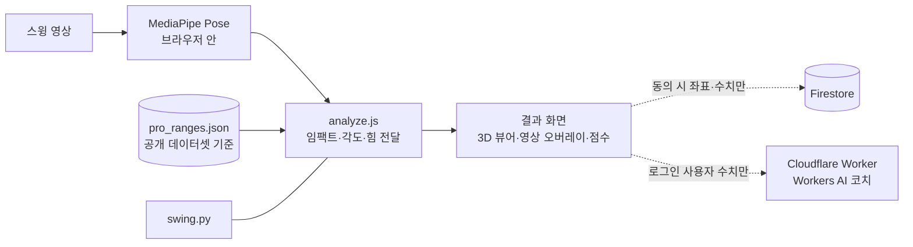

# TTT — 탁구 스윙 3D 분석

휴대폰으로 찍은 스윙 영상 하나로 3D 자세를 복원하고, 프로 기준과 비교해 고칠 점을 알려 주는 웹앱.

**▶ [바로 쓰기](https://hooni9807.github.io/ttt/)**

> 2026-10-26 ~ 2026-10-27 · 커밋 37개 · 1인 개발 (AI 페어 프로그래밍)

---

## 1. 왜 만들었나

- **문제**: 레슨에서 고친 자세가 혼자 칠 때도 유지되는지 확인할 방법이 없다. 영상을 봐도 무엇이 틀렸는지 숫자로 알기 어렵다.
- **목적**: 영상 하나로 임팩트 속도, 관절 각도, 힘 전달 순서를 숫자로 보여 주고, 다음 연습에서 고칠 한 가지를 알려 준다.
- **대상**: 생활체육 탁구 동호회 아마추어. 탁구장에서 폰을 세워 찍고, 그 자리에서 폰 브라우저로 확인한다.

### 처음에 정한 원칙

([PRODUCT.md](PRODUCT.md)에 기록)

1. 영상은 기기 밖으로 나가지 않는다. 분석은 브라우저 안에서 한다.
2. 숫자보다 "다음에 고칠 한 가지"가 먼저 보인다.
3. 프로 기준의 출처와 한계를 정직하게 표시한다.

## 2. 설계



| 결정 | 이유 |
|---|---|
| 정적 페이지(`index.html` + `analyze.js`), 빌드 없음 | GitHub Pages에 올리면 바로 쓴다. 운영 서버가 없다. |
| 포즈 추정은 브라우저에서 MediaPipe로 | 영상을 서버로 보내지 않아도 된다. 설치·가입이 필요 없다. |
| 같은 분석을 Python(`swing.py`)으로도 구현 | `test_swing.py`가 웹(`analyze.js`)과 Python 결과를 대조해 계산 실수를 잡는다. |
| 프로 기준은 공개 데이터셋을 같은 코드로 분석 | 논문 값만으로는 기준이 3개뿐이었다. 같은 측정 방식으로 만든 범위가 비교에 맞다. |
| AI 코치는 Cloudflare Worker + Workers AI | 프롬프트를 서버에서 만들고, 영상·좌표 없이 분석 수치만 보낸다. |

## 3. 개발 과정

이틀 동안의 커밋을 기능 단위로 묶었습니다.

| 단계 | 기간 | 한 일 |
|---|---|---|
| **0. 분석 엔진** | 10-26 | MediaPipe 3D 자세 분석(`swing.py`)과 3D 뷰어. 논문 범위·직접 만든 프로 분석과 비교 |
| **1. 웹 앱** | 10-26 | 브라우저에서 영상을 올려 분석하는 페이지. 탁구대 모양으로 디자인. 15초 분석 제한 |
| **2. 결과 화면** | 10-26 | 3D 뷰어 재작성(마네킹, 궤적 튜브, 카메라 프리셋). 원본 영상 위 2D 스켈레톤, 영상·스켈레톤·궤적 토글 |
| **3. 점수와 피드백** | 10-26 | 항목별 10점 점수와 종합 점수, 스윙 면 기울기, 슬로모션 기본 재생(0.25배) |
| **4. 저장과 공유** | 10-26 | 결과 저장, 이미지 카드 저장, 스켈레톤 영상 저장. 카카오톡 인앱 브라우저 대응 |
| **5. 데이터와 계정** | 10-26 | 동의한 경우만 좌표 데이터 보내기(Firebase), Google 로그인과 개인 기록, 관리자용 라벨링 페이지와 점수 학습 스크립트(`train_scorer.py`) |
| **6. AI 코치** | 10-26 ~ 10-27 | Cloudflare Worker + Workers AI 코치, 모델을 Qwen3 30B로 교체. 원인·결과·교정 형식, 자연스러운 한국어, 왼손잡이 좌우 반전 |
| **7. 기준 교체** | 10-27 | 공개 도 대표 선수 데이터셋으로 프로 기준 재작성, 힘 전달을 타이밍 범위로 판정. 스윙 고르기 기능 제거 |

## 4. 트러블슈팅

### 1) 백스윙·피니시가 엉뚱한 동작에 잡힘

- **문제**: 궤적이 영상 거의 전체를 덮었다.
- **원인**: 영상 전체에서 백스윙과 피니시를 찾다 보니, 걷거나 공을 줍는 동작이 백스윙·피니시로 잡혔다.
- **해결**: 임팩트 0.8초 전부터 0.6초 뒤까지만 찾도록 `swing.py`와 `analyze.js`를 함께 고쳤다(e223b2b).
- **결과**: 스윙 구간만 궤적으로 그려진다.

### 2) 프로 기준이 너무 적었다

- **문제**: 처음 기준은 논문 3편에서 가져온 값 3개뿐이었다(손 속도, 백스윙·피니시 무릎 각도). 팔꿈치·몸통 꼬임 기준이 없었고 측정 장비도 달랐다.
- **해결**: 공개 데이터셋(Lyu et al. 2025, CC BY 4.0)의 도 대표 선수 34명 포핸드 340개를 TTT와 같은 코드로 분석해 `pro_ranges.json`을 다시 만들었다. 힘 전달도 교과서식 순서 규칙 대신 데이터의 최고 속도 타이밍 범위로 판정한다(a71de00).
- **결과**: 이 데이터에서 TTT의 임팩트 판정은 실제 임팩트와 중앙값 2프레임(20ms) 차이였다(96%가 3프레임 이내).
- **버린 것**: 자세로 공 속도를 맞히는 모델도 학습했지만, 평균만 찍는 것과 오차 차이가 작아(3.1 vs 3.3 km/h) 사이트에 넣지 않았다.

### 3) 카카오톡 인앱 브라우저에서 저장이 안 됨

- **문제**: 사용자는 카카오톡 링크로 들어오는데, 결과 저장을 누르면 지원하지 않는 형식이라는 오류가 났다.
- **원인**: 카카오톡 웹뷰가 페이지에서 만든 파일의 다운로드를 막는다.
- **해결**: user agent로 감지해 외부 브라우저로 다시 여는 링크를 보여 주고, 결과 카드는 전체 화면으로 띄워 길게 눌러 저장하게 했다(731ab53). 이후 Chrome을 자동으로 열도록 바꿨다(d75f691).

## 5. 실행 방법

**웹**: 정적 파일이라 아무 정적 서버로 열면 됩니다.

```bash
python -m http.server 8765 --bind 127.0.0.1
```

**명령줄**: [uv](https://docs.astral.sh/uv/)가 필요합니다. 처음 실행할 때 포즈 모델(약 30MB)을 내려받습니다.

```bash
uv run swing.py 내스윙.mp4            # 오른손잡이
uv run swing.py 내스윙.mp4 --left     # 왼손잡이
uv run test_swing.py                 # 테스트 (node가 있으면 analyze.js와도 대조)
```

**AI 코치 Worker**: `cd worker && npx wrangler deploy`

**촬영 팁**: 폰을 세워 고정하고 몸 전체가 나오게, 60fps 이상으로, 영상 하나에 스윙 한 번(15초 이내)만 찍어 주세요.

## 6. 한계와 다음 계획

- **깊이 추정**: 카메라 한 대로 추정한 깊이(z)는 오차가 크다. WHAM, 4D-Humans 같은 모델을 검토할 수 있다.
- **라켓·공**: 추적하지 않는다. 객체 검출 모델을 따로 학습시켜야 한다.
- **기준의 한계**: 프로 데이터는 오른쪽 앞 45°, 100fps로 찍었다. 촬영 각도가 다르면 차이가 날 수 있어 참고용이다.
- **평가 AI**: 라벨링 페이지와 학습 스크립트는 있지만, 믿을 만하려면 점수 매긴 스윙이 50개 이상 필요하다.
- **AI 활용**: 커밋 37개 모두 Claude와 함께 작성했다.
